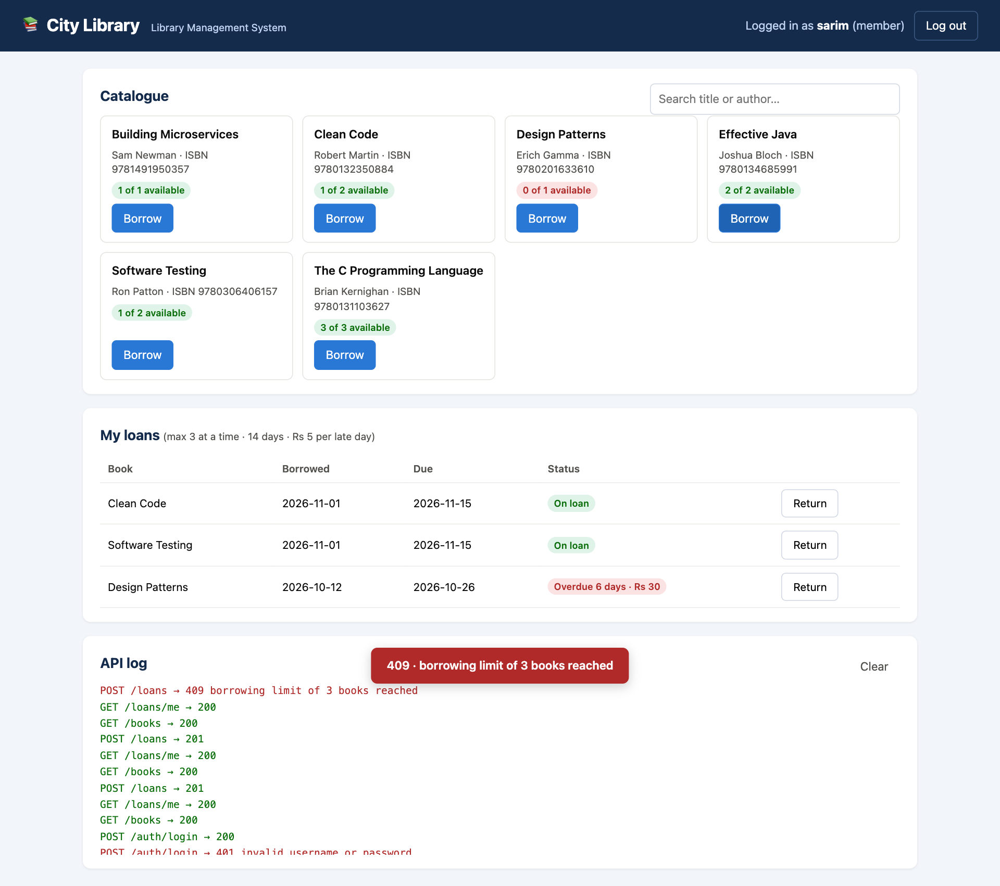

# Library Management System: Software Testing Project

Course project for **Software Testing**, B.Tech CSE, Manipal University Jaipur (2026-27).
Sarim Khan (23F10CSE00486).

A small library website and **REST API** (Flask + SQLite) and an automated **pytest** suite of
**45 test cases** that checks it. Members register, log in, search books, borrow up to 3 books
for 14 days and pay Rs 5 per day if late. The admin (librarian) manages the catalogue.

| Deliverable | File |
|---|---|
| Testing report (Word) | [`docs/Software_Testing_Report.docx`](docs/Software_Testing_Report.docx) |
| Slides (PowerPoint) | [`slides/Library_Management_Testing.pptx`](slides/Library_Management_Testing.pptx) |
| Test results of every cycle | [`reports/`](reports/) (JUnit XML + console output + coverage) |



## Results

| Cycle | Code | Passed | Failed |
|---|---|---|---|
| 1 | v1.0 (first version) | 23 | 22 |
| 2 | v1.0 + crash fix (DEF-01) | 40 | 5 |
| 3 | v1.1 (all fixes) | **45** | **0** |

135 executions in total, 108 passed (80.0%); final cycle 45/45 with 98.5% statement coverage.
Testing found 6 real defects (all fixed) and 3 more by code review (open/deferred). See the defect
log in the report.

---

## Run it on Windows (step by step)

You only need **Python**. Everything else installs with one command (3 small packages, no compilers).

### 1. Install Python (one time)

1. Go to <https://www.python.org/downloads/windows/> and download **Python 3.12** (64-bit installer).
2. Run it and **tick "Add python.exe to PATH"** at the bottom of the first screen, then click *Install Now*.
3. Open **Command Prompt** (press `Win`, type `cmd`, Enter) and check:
   ```
   python --version
   ```
   It should print `Python 3.12.x`.

### 2. Get the project

Either download it from GitHub (**Code → Download ZIP**, then right-click → *Extract All*), or:
```
git clone https://github.com/sarimkhan-sketch/library-management-testing.git
```

### 3. Open a terminal in the project folder

Open the extracted `library-management-testing` folder in File Explorer, click the address bar,
type `cmd` and press Enter. A Command Prompt opens already inside the folder.

### 4. Set up (one time)

```
python -m venv .venv
.venv\Scripts\activate
python -m pip install -r requirements.txt
```
After `activate` the prompt starts with `(.venv)`. Next time, only run `.venv\Scripts\activate`.

### 5. Start the website

```
python run.py
```
Open **<http://127.0.0.1:5000>** in Chrome or Edge. The terminal prints the logins:

| Account | Username | Password |
|---|---|---|
| Member (has one overdue book) | `sarim` | `secret123` |
| Admin (librarian) | `admin` | printed in the terminal (saved in `instance\admin_password.txt`) |

Press `Ctrl+C` in the terminal to stop. `python run.py --reset` starts again with fresh sample data.
The server listens on `127.0.0.1` only, so nobody else on the network can reach it and Windows
Firewall will not ask for permission.

### 6. Demo script (about 5 minutes)

Keep the terminal and the browser side by side. The **API log** at the bottom of the page shows every
request with its HTTP status code, so each step below is a visible test case.

| # | Do this on the page | You should see | Test case |
|---|---|---|---|
| 1 | Search `clean` (as guest) | only *Clean Code* | TC-25 |
| 2 | Log in as `sarim` with a wrong password | red `401 · invalid username or password` | TC-17 |
| 3 | Log in as `sarim` / `secret123` | *Design Patterns* is **Overdue 6 days · Rs 30** | |
| 4 | Borrow *Software Testing* and *Clean Code* | copies drop (e.g. 2 → 1 available) | TC-32 |
| 5 | Borrow a 4th book | red `409 · borrowing limit of 3 books reached` | TC-35 (was DEF-03) |
| 6 | Borrow *Clean Code* again | `409 · you already have this book` | TC-34 |
| 7 | Return *Design Patterns* | `Returned late · fine Rs 30` | TC-38 |
| 8 | Log out, log in as `admin` | admin panel appears | TC-21 |
| 9 | Add a book with ISBN `9780306406158` | `400 · isbn checksum is invalid` | TC-22 |
| 10 | Add it with ISBN `9781617294136` | new book card appears | TC-20 |
| 11 | *Copies…* on a borrowed book, enter `0` | `400 · total_copies must be…` | TC-29 (was DEF-05) |
| 12 | *Delete* a book that is on loan | `409 · book has loan records…` | TC-30 (was DEF-06) |
| 13 | Back in the terminal: `python -m pytest -v` | 45 passed | all |

### 7. Other commands

| What | Command |
|---|---|
| Run all 45 tests (about 7 s) | `python -m pytest -v` |
| Tests + coverage table | `python -m pytest --cov=library --cov-report=term-missing` |
| One test only | `python -m pytest -v -k tc35` |
| Same flow as the website, in the terminal only | `python demo.py` |
| Browser check of the web page (optional) | `python -m pip install -r requirements-ui.txt` then `python scripts/ui_check.py` |

`scripts/ui_check.py` drives Microsoft Edge (already on every Windows laptop) with Playwright through
14 checks and saves screenshots to `reports/figures/`. Add `--show` to watch it click through the page.

### If something goes wrong

| Problem | Fix |
|---|---|
| `'python' is not recognized` | Reinstall Python and tick **Add python.exe to PATH**, then open a new Command Prompt. Or use `py` instead of `python`. |
| `python` opens the Microsoft Store | Settings → Apps → Advanced app settings → App execution aliases → turn off the two *python* aliases. |
| `running scripts is disabled on this system` (PowerShell) | Use Command Prompt (`cmd`) instead, or run `Set-ExecutionPolicy -Scope Process Bypass` first. |
| `No module named flask` / `pytest` | The venv is not active: run `.venv\Scripts\activate`, then step 4's `pip install` again. |
| Port 5000 already in use | Close the other program, or just use `python demo.py`, which needs no port. |
| Page still shows an old login after restarting | Click *Log out*, or refresh the page. |

On macOS/Linux the steps are the same except `source .venv/bin/activate`.

---

## Project layout

```
library/                the application
  __init__.py           create_app(): config, blueprints, JSON error pages
  db.py                 SQLite schema (users, tokens, books, loans) and admin account
  validators.py         username, password, ISBN-13 checksum, copies, text rules
  auth.py               register / login / logout, login_required, admin_required
  books.py              search (public); add, update, delete (admin)
  loans.py              borrow, return, 3-book limit, 14-day loans, Rs 5/day fine
  static/               web page: index.html, app.js, style.css (plain JS, no build step)
tests/                  45 test cases, one pytest function per test case (TC-01 ... TC-45)
  conftest.py           fresh temporary database per test, fixed clock, API helpers
  test_phase1_validation.py   Phase 1: unit, BVA, ECP
  test_phase2_auth.py         Phase 2: authentication and security
  test_phase3_books.py        Phase 3: catalogue, roles, database
  test_phase4_loans.py        Phase 4: lending rules
  test_phase5_integration.py  Phase 5: end-to-end, SQL injection, error handling
reports/cycle1..3/      JUnit XML and console output of each test cycle; coverage.json (cycle 3)
scripts/                report_data.py, make_figures.py, build_report.py, ui_check.py
slides/build_slides.py  builds the slides
run.py                  starts the website on 127.0.0.1:5000 with sample data
demo.py                 terminal-only walkthrough of the same flow
```

Each test's docstring holds its scenario, steps, expected result and priority. The report and slides
are generated from those docstrings and the JUnit results, so the documents always match the tests.

## API

| Method | URL | Who | Purpose |
|---|---|---|---|
| GET | `/` | anyone | the web page |
| POST | `/auth/register` | anyone | create a member account |
| POST | `/auth/login` | anyone | returns a token; send it as `Authorization: Bearer <token>` |
| POST | `/auth/logout` | logged in | delete the token |
| GET | `/books?q=text` | anyone | search title or author |
| GET | `/books/<id>` | anyone | one book |
| POST / PUT / DELETE | `/books`, `/books/<id>` | admin | manage the catalogue |
| POST | `/loans` `{"book_id": 1}` | logged in | borrow |
| POST | `/loans/<id>/return` | owner or admin | return, calculates fine |
| GET | `/loans/me` | logged in | own loans |
| GET | `/loans?overdue=1` | admin | all (or overdue) loans |

## Rebuilding the report and slides (optional)

```
python -m pip install -r requirements-docs.txt
python scripts/make_figures.py
python scripts/build_report.py
python slides/build_slides.py
```
